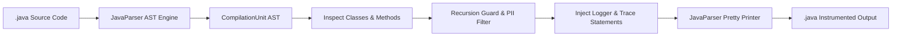

# ⚡ JavaFunctionLogger • AST Code Instrumentation & Observability CLI

[](https://openjdk.org/)
[](https://javaparser.org/)
[](https://picocli.info/)
[](https://logging.apache.org/log4j/2.x/)
[](https://junit.org/junit5/)
[](LICENSE)

An automated **Abstract Syntax Tree (AST)** code instrumentation and observability tool built with **Java 17**, **JavaParser**, and **Picocli**. It recursively parses Java source trees, injects `Log4j2` loggers, and adds runtime method trace statements (with parameter values, PII redaction, array formatting, and execution timing) without breaking compilation or code formatting.

---

## 🌟 Key Highlights & Engineering Features

- **True AST Manipulation (Not Fragile Regex):**
  Uses **`JavaParser`** to build a full syntactic model of Java source files. Handles generics, annotations, overloaded methods, interfaces, and nested classes accurately.
- **Safe Logger Injection:**
  Detects whether a class already has a `Logger` field or imports. If missing, cleanly adds `org.apache.logging.log4j.LogManager` / `Logger` imports and injects `private static final Logger logger = LogManager.getLogger(ClassName.class);` directly into the class body.
- **Dynamic Parameter Tracing & Array Formatting:**
  Inspects method parameters and generates structured trace statements (e.g. `logger.trace("[OrderService#process] Called with: id=" + id + ", tags=" + java.util.Arrays.toString(tags));`).
- **PII & Secret Redaction (Security Compliant):**
  Automatically masks sensitive arguments (`password`, `secret`, `token`, `key`, `pin`, `credential`, `auth`) with `"[REDACTED]"` to prevent sensitive data leakage into application logs (GDPR & PCI-DSS ready).
- **Infinite Recursion Guard:**
  Automatically skips `toString()`, `hashCode()`, `equals()`, `finalize()`, and `clone()` to prevent accidental `StackOverflowError` caused by recursive logging calls.
- **Execution-Time Profiling (`--timing`):**
  Optionally injects high-precision execution timestamps (`System.currentTimeMillis()`) to profile slow methods and bottlenecks.
- **Non-Destructive Backups (`--backup`):**
  Optionally generates a `.bak` backup copy of every source file before applying mutations in-place.
- **Exclusion Filters (`--exclude`):**
  Supports regex-based path and file filtering (e.g., `--exclude ".*Test.*"`).
- **Interactive CLI & Dry-Run Mode:**
  Powered by `picocli` with colorful ASCII banners, progress logging, and `--dry-run` to preview AST mutations without writing changes to disk.
- **Idempotent by Design:**
  Can be safely re-run across a codebase without duplicating loggers or trace statements.

---

## 🏗️ AST Transformation Workflow



---

## 🔄 Code Transformation (Before & After)

### Before Instrumentation:
```java
package com.example.service;

public class OrderService {
    public OrderResult placeOrder(String customerId, String authToken, int[] itemIds) {
        // Business logic here
        return new OrderResult("SUCCESS");
    }
}
```

### After Instrumentation:
```java
package com.example.service;

import org.apache.logging.log4j.LogManager;
import org.apache.logging.log4j.Logger;

public class OrderService {
    private static final Logger logger = LogManager.getLogger(OrderService.class);

    public OrderResult placeOrder(String customerId, String authToken, int[] itemIds) {
        logger.trace("[OrderService#placeOrder] Called with: customerId=" + customerId + ", authToken=" + "[REDACTED]" + ", itemIds=" + java.util.Arrays.toString(itemIds));
        final long _methodStartTime = System.currentTimeMillis();

        // Business logic here
        return new OrderResult("SUCCESS");
    }
}
```

---

## 🚀 Quickstart & Usage

### 1. Build and Test
```bash
git clone https://github.com/Tom7668h/JavaFunctionLogger.git
cd JavaFunctionLogger
mvn clean test
```

### 2. Package Standalone Executable Fat JAR
```bash
mvn package -DskipTests
```
This produces `target/JavaFunctionLogger-1.0.0.jar` with all dependencies bundled inside.

### 3. Run Instrumentation CLI
```bash
# Preview modifications on target project without modifying disk
java -jar target/JavaFunctionLogger-1.0.0.jar --dry-run /path/to/my-java-project

# Instrument with execution timing and automatic .bak backups
java -jar target/JavaFunctionLogger-1.0.0.jar --timing --backup /path/to/my-java-project

# Instrument excluding test classes
java -jar target/JavaFunctionLogger-1.0.0.jar --exclude ".*Test.*" /path/to/my-java-project
```

### CLI Options:
| Flag | Description |
| :--- | :--- |
| `<directoryPath>` | Target directory to recursively scan and instrument (default: `.`) |
| `-b, --backup` | Create a `.bak` backup file before modifying files |
| `-d, --dry-run` | Preview modifications in console without writing changes to disk |
| `-e, --exclude=<regex>` | Regular expression for file paths to exclude from instrumentation |
| `-t, --timing` | Inject execution time measurement (`_methodStartTime`) |
| `-v, --verbose` | Verbose debug console logging |
| `-V, --version` | Print version information and exit |
| `-h, --help` | Show command line options and exit |

---

## 📄 License
MIT License. Created by [Tom7668h](https://github.com/Tom7668h).
